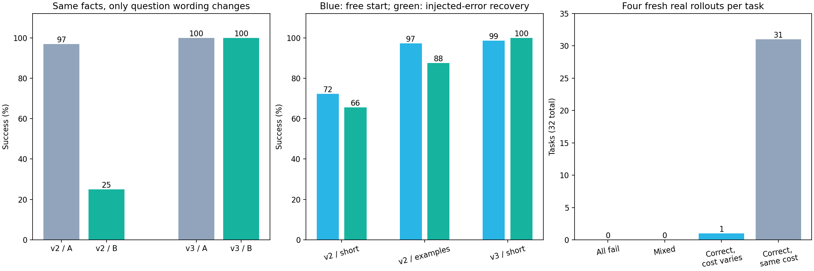

# Budgeted Tool RL

A controlled private-database environment for studying **when a small language model should query a tool, and when it should answer**.

This repository implements the environment, actual Qwen3-0.6B CUDA baselines, paired prompt controls, measured local LoRA SFT and continuation, and fresh rollout reward diagnostics. The environment is synthetic; model responses and optimizer updates are real. RL optimization remains a future stage.

## Branch decisions and weighted tool costs (paused before new SFT)

The latest experiment was stopped at the user's request on 2026-10-12.
It adds fresh facts, observation-dependent branches and priced query choices.
With the existing v3 adapter, free-start grounded success is **37/128** under
the short protocol and **128/128** with examples; injected ID-error recovery
is **10/64** and **17/64** respectively. Strong-prompt successful free-start
trajectories still incur **218 synthetic fee units** of total cost regret.
These new tasks and weighted rewards differ from earlier benchmarks.

Four completed training-collection cohorts found **zero eligible natural
single-character ID-copy failures** across 512 episodes. The correction-training
gate refused that empty set. A preregistered, training-only hinted/high-temperature
probe was interrupted after **74/128** records. **No v4 SFT, new
training-memory measurement or fresh v4 32×4 reward diagnosis was performed.**
Completed and partial raw records are retained; the interrupted manifest is
preserved with an explicit stop sidecar, rather than relabeled complete.

Read the [current Chinese status and baseline analysis](results/sft-v4/status.zh-CN.md),
[stop record](results/sft-v4/interruption/user-stop.json),
[baseline metrics](results/sft-v4/baseline-before-training.json), and
[prospective reproduction protocol](results/sft-v4/reproduce.md).

## Wording control and invalid-query correction SFT

A real **32-fact, two-wording, two-seed paired experiment** holds database,
faults, target, system prompt, budget and within-pair generation seeds fixed.
Only question wording and logging labels differ. With the v2 adapter,
wording A/B succeeds 62/64 and
16/64 times; first-action project.employee
misuse occurs 0/64 and
45/64 times respectively. The pair
analysis was saved before training. Repeated seeds are correlated; the
independent fact count is 32. Supplied-prefix tasks serve as controls.

Then v2 was continued on **300 new fact-disjoint trajectories / 1,095
assistant-only next-action targets**: 80 executed unknown_field prefixes,
80 executed unknown_entity prefixes, and 140 clean/chain/recoverable-error/
known-information/retained-budget examples. Bad prefixes are scripted,
actually executed, fully masked inputs; they are not supervised targets or
claims of naturally sampled model failures. Correction SFT also broadens
wording coverage, so its training components have not been separately ablated.

| Fixed condition | Free-start test (72 tasks x 2) | Injected-error recovery (32 tasks x 2) |
|---|---:|---:|
| old/protocol | 104/144 (72.2%) | 42/64 (65.6%) |
| old/examples | 140/144 (97.2%) | 56/64 (87.5%) |
| new/protocol | 142/144 (98.6%) | 64/64 (100.0%) |

The free-start test holds out complete wording and facts. The injected-error
test starts from recorded tool state and charges the injected error to the
normal six-call/seven-turn budget; it measures conditional recovery rather
than spontaneous mistakes. Post-training A/B paired successes are
64/64 and 64/64;
that is a diagnostic regression check, since those wording families are
included in training on different facts.

One new free-start fact fails under both roots because the model drops an
internal character while copying the project ID, then repeats that invalid
ID. This is a real residual regression, beyond the scripted type-word and
suffix-error prototypes. Relative to v2/examples, four matched attempts are
gained and two are lost; conditional recovery at 64/64 does not establish
universal unknown_entity correction. Recovery error types also use different
wording templates, so their score differences cannot isolate error-type
difficulty.

After the controls were analyzed, **32 entirely new tasks x four actual
rollouts** succeeded 128/128 times. The unchanged gated
correctness/call-cost reward has **1/32
nonconstant groups**: `{"all_correct_same_cost": 31, "all_correct_different_cost": 1}`. This is reward diagnosis;
**no RL optimization or invented old-policy log probabilities** are involved.
Different-fact signal rounds are not a paired causal comparison.

Formal GRPO is deferred: the held-out diagnostic has sparse effective groups. The next step is fresh training facts with observation-dependent branching and legal query-cost choices, followed by another independent signal audit.

All **1086 episodes / 4168
generation requests** were replayed and checked against actual tokens,
observations, answers, costs and frozen provenance. One epoch uses
137 optimizer steps with checkpointing and per-update
empty_cache; peak allocated/reserved memory is
2.55/7.35 GiB.
These process metrics do not establish exclusive physical-VRAM residency or
general agent/RSI capability. Existing evidence and adapters remain unchanged.

Read the [Chinese analysis and next-step decision](results/sft-v3/analysis.zh-CN.md),
[paired-before-training evidence](results/sft-v3/paired-before-training.json),
[audited metrics](results/sft-v3/summary.json),
[fresh per-task rewards](results/sft-v3/reward-signal.json),
[training audit](results/sft-v3/training-audit.json),
[report-only empty-subgroup fix](results/sft-v3/report-only-amendment.json),
[per-family and error-position breakdown](results/sft-v3/descriptive-breakdown.zh-CN.md),
[reproduction](results/sft-v3/reproduce.md), and
[adapter model card](results/sft-v3/model-card.md).



## SFT continuation and fresh reward diagnostics

The existing adapter was continued locally on **300 new executed oracle
trajectories / 990 assistant-only next-action targets**, including 80 states
immediately after actual recoverable errors. A fixed one-epoch continuation
used **124 optimizer steps**; the initial adapter state exactly matches v1.
Train/dev/test/signal and historical facts are disjoint. Test wording is held
out; training reuses earlier stress-test wording on new facts.

| Condition | Correct / attempts | Success | Strict JSON + correct | Extra calls on correct attempts |
|---|---:|---:|---:|---:|
| Base / fixed examples | 77/216 | 35.6% | 77/216 | 0 |
| Old SFT / short protocol | 120/216 | 55.6% | 120/216 | 3 |
| Old SFT / same examples | 199/216 | 92.1% | 199/216 | 2 |
| Continued SFT / short protocol | 216/216 | 100.0% | 216/216 | 0 |

Each condition repeats **72 independent test tasks × three seeds = 216
attempts**. Repeated attempts are correlated. New-model all-three-correct
tasks: **72/72**.
Task families include three/four-hop chains, retries, canonical-ID redirects,
supplied facts and retained one-step budget queries. No action repair or
forced decoding is used. The base example prompt remains fixed from the
previous development selection.

After completing and analyzing all controls, the continued model sampled
**32 fresh tasks × four real rollouts = 128 attempts** under the short
protocol. These include long-chain/fault and supplied-prefix/fault compositions.
Answer success was **80/128**; **0/32
groups** had nonconstant gated correctness/call-cost rewards. The four-reward
classification is `{"all_correct_same_cost": 20, "all_failed": 12}`. Constant-reward groups provide
no within-group reward ranking. **No RL optimization was performed.**

The fresh probe changes wording as well as fault composition. In 47 of the
48 failed attempts, the first action queries an illegal project field
`employee` instead of `owner`, then often fails to use the returned
`allowed_fields`. All 64 attempts that actually reach a configured recoverable
error succeed. Long-chain success separates by wording template, but the
strata use different facts, so this is an association rather than a paired
causal comparison. Before GRPO, run same-fact wording controls and add
executed invalid-query states with valid field/entity corrections to SFT;
preserve this test and signal set as historical evidence and generate new
training and final-evaluation tasks.

Final training used non-reentrant gradient checkpointing. Peak PyTorch
allocation was **2.40 GiB**, with
**8.28 GiB reserved**. The optimization loop
took 1417.46 seconds under concurrent GPU load.
Three discarded resource attempts and a memory-only plan amendment are
preserved; no partial weights were reused. Reserved memory exceeded nominal
VRAM, so completion does not establish exclusive physical-VRAM residency or
RL training-memory feasibility on other systems.

All **1100 evaluation/diagnostic episodes /
3086 model requests** were independently replayed,
regraded and checked against input/output tokens. Exact teacher labels,
single-epoch coverage, saved LoRA tensors and frozen provenance were audited.
The old checkpoint bytes remain unchanged. Results concern this controlled
synthetic English schema, not general agent or RSI capability.

Read the [Chinese continuation analysis and next-step decision](results/sft-v2/analysis.zh-CN.md),
[audited metrics and paired comparisons](results/sft-v2/summary.json),
[32 groups with actual rewards](results/sft-v2/reward-signal.json),
[training audit](results/sft-v2/training-audit.json),
[resource-plan amendment](results/sft-v2/resource-amendment.json),
[reproduction](results/sft-v2/reproduce.md), and
[adapter model card](results/sft-v2/model-card.md).


## Difficulty upgrade: frozen-model transfer test

The existing adapter and base model were evaluated locally,
with **no new training**. New tasks add three/four-hop queries, deterministic
retry and canonical-ID recovery, and supplied facts that make queries redundant.
Both models receive the full tool contract. The base prompt was selected from
two fixed candidates on a separate 24-scenario development set before testing.

| Family | Minimum calls | Base / dev-best examples | Existing SFT / short protocol | Existing SFT / same examples |
|---|---:|---:|---:|---:|
| Two-hop anchor | 2 | 0/24 | 11/24 | 24/24 |
| Three-hop | 3 | 0/24 | 12/24 | 15/24 |
| Four-hop | 4 | 0/24 | 0/24 | 24/24 |
| Transient error + retry | 3 | 0/24 | 3/24 | 24/24 |
| Stale ID + redirect | 3 | 0/24 | 10/24 | 24/24 |
| Owner provided | 1 | 24/24 | 21/24 | 24/24 |
| Chain prefix provided | 1 | 24/24 | 1/24 | 24/24 |
| Answer provided | 0 | 24/24 | 24/24 | 24/24 |
| **Overall** | — | **72/192 (37.5%)** | **82/192 (42.7%)** | **183/192 (95.3%)** |

Each policy has **64 test scenarios × three seeds = 192 attempts**. Scenarios
come from 24 fact groups with matched normal/fault/supplied-fact variants;
neither the scenarios nor repeated seeds are independent samples. Entities and
private values are disjoint from development and previous SFT data. Test wording
is held out from this experiment's development templates.

The matched example prompt makes the frozen SFT model substantially more
reliable than the short protocol. Remaining failures include simulated tool
transcripts; short-protocol failures also include null answers and unsupported
reverse-lookup arguments. Successful low-call trajectories are separated from
early failures, and required recovery is not counted as redundant repetition.
Prompt dependence should be addressed before claiming robust agent behavior.

**672 real episodes / 1720 model requests** were
independently replayed and checked against recorded input/output tokens.
Peak PyTorch allocation was **1.73 GiB**,
with **3.28 GiB reserved**; these are inference measurements.
The original adapter files still match the frozen hashes. RL remains unrun;
the report makes a data-based decision about the next experiment.

Read the [Chinese stress-test analysis and RL decision](results/stress-v1/analysis.zh-CN.md),
[audited metrics and paired comparisons](results/stress-v1/summary.json),
[dev-only prompt selection](results/stress-v1/selection.json),
[actual diagnostic trajectories](results/stress-v1/diagnostic-cases.jsonl),
and [reproduction instructions](results/stress-v1/reproduce.md).

## Previous local LoRA SFT

The local LoRA SFT run completed **300 oracle trajectories / 600 assistant decision targets**, one epoch and **75 optimizer steps**. Peak PyTorch allocation was **2.88 GiB**, with **4.84 GiB reserved**; the optimization loop took 102.58 seconds. The longest actual training sequence was 406 tokens. These measurements apply to this short-context LoRA workload.

The new generator uses independent opaque project/employee IDs, disjoint train/dev/test facts, 40 within-train goal-contrast pairs and held-out test paraphrases. Training uses assistant-only loss, BF16 frozen base weights, FP32 q/v LoRA rank 8 and a fixed final checkpoint. A separate eight-step backward/optimizer memory probe was discarded before full training.

| Condition | Direct | One lookup | Two lookups | Overall |
|---|---:|---:|---:|---:|
| Base / neutral | 60/60 | 25/60 | 0/60 | 85/180 (47.2%) |
| Base / previously strongest examples | 60/60 | 22/60 | 0/60 | 82/180 (45.6%) |
| SFT / neutral | 60/60 | 60/60 | 60/60 | 180/180 (100%) |
| SFT / same examples | 60/60 | 51/60 | 60/60 | 171/180 (95.0%) |

Each condition repeats the same 60 unique test tasks under three sampling seeds; the 180 attempts are correlated. The previous strongest examples remain a frozen baseline, but neutral is slightly stronger on this new test. SFT improves actual owner → department chaining; adding examples to SFT regresses nine budget attempts to answering without lookup. All SFT neutral requests are valid raw JSON and all correct trajectories use the minimum calls.

**840 real evaluation episodes / 1,356 model requests** were independently replayed, regraded and checked for input/output token provenance. The fixed adapter was saved before any test generation. This is a controlled English-schema result, not evidence of general agent competence. This saturation motivated the separate difficulty upgrade reported above.

Read the [Chinese SFT analysis](results/sft-v1/analysis.zh-CN.md), [audited experiment metrics](results/sft-v1/summary.json), [training and checkpoint audit](results/sft-v1/training-audit.json), [reproduction commands](results/sft-v1/reproduce.md), and [adapter model card](results/sft-v1/model-card.md). The small LoRA adapter is included; base weights are excluded.

## Historical 100-task baseline

The baseline run completed all 100 development tasks without OOM: **59/100 correct with narrow code-fence normalization; 7/100 correct with strict raw-JSON compliance throughout**.

| Family | Correct / tasks | Success |
|---|---:|---:|
| direct | 34 / 34 | 100% |
| one_lookup | 25 / 33 | 75.8% |
| two_lookup | 0 / 33 | 0% |

Inference took 226.30 seconds, at 14.17 generated tokens/second including request prefill and sampling. Peak PyTorch CUDA allocation was 1,239 MiB (1.21 GiB). Other desktop GPU workloads were active. These are inference measurements, not training-memory estimates.

All two-lookup tasks answered without querying. Five failed budget tasks successfully queried owner then department, but answered the wrong goal. Correct trajectories already use the minimum number of calls. This diagnosis led to the prompt controls and goal-conditioned LoRA SFT below; call-cost optimization still needs additional tasks with actual redundancy.

Read the [Chinese analysis and training decision](results/dev100/analysis.zh-CN.md), [machine-readable metrics](results/dev100/summary.json), [raw trajectories](results/dev100/episodes.jsonl), and [independent verification](results/dev100/verification.json). Verification replays tools and checks input/output token provenance for all 139 model requests.

## Prompt controls completed

Four prompt configurations were tested on the same 60 new development tasks with three seeds each: **720 real CUDA episodes, 920 independently verified model requests, no training**. Each prompt has 180 attempts over 60 shared tasks; repeated seeds are correlated.

| Prompt | Direct | One lookup | Two lookups | Overall | Strict JSON + correct |
|---|---:|---:|---:|---:|---:|
| Original | 60/60 | 55/60 | 0/60 | 63.9% | 7.2% |
| Neutral (one sentence ablation) | 60/60 | 44/60 | 0/60 | 57.8% | 13.9% |
| Balanced examples in system | 60/60 | 60/60 | 0/60 | 66.7% | 66.7% |
| Role-based conversation examples (exploratory follow-up) | 60/60 | 0/60 | 0/60 | 33.3% | 33.3% |

The first three conditions were fixed before inference. The fourth was added after inspecting the first inline-example seed and is labeled separately. System examples produced valid raw JSON for all 278 requests and started lookup in 38/60 two-hop attempts, but every two-hop attempt stopped after at most one lookup. Conversation examples regressed to copying example values or extracting entity digits without querying.

Read the [Chinese comparison analysis](results/prompt-control-v1/analysis.zh-CN.md), [detailed metrics and reproduction](results/prompt-control-v1/metrics.zh-CN.md), [primary summary](results/prompt-control-v1/summary.json), [follow-up summary](results/native-examples-v1/summary.json), and [proposed SFT experiment](results/prompt-control-v1/sft-decision.zh-CN.md).

This diagnosis led to the completed SFT experiment: the new generator fixes the shared project/employee ID suffix, establishes held-out-paraphrase evaluation and reruns fresh base controls. The historical datasets and traces retain their original bytes. Prompt gains are evidence of sensitivity; continued failure alone does not prove a model capacity ceiling.

## Task families

| Family | Requested information | Minimum lookup calls | Historical 100-task dev set |
|---|---|---:|---:|
| direct | Budget is given in the question | 0 | 34 |
| one_lookup | Project budget is private | 1 | 33 |
| two_lookup | Department of a project's owner | 2 | 33 |

The model sees only the question and system protocol, then the tool outputs it requests. During evaluation it never receives the expected answer, oracle path or entire database. The historical generator used separate episode facts. The new SFT generator additionally reuses 40 fact groups under different goals within train only; dev/test remain disjoint.

The historical 100 tasks are **development probes** used to diagnose behavior and decide the next training step. They are not the new SFT test set. Nine separate calibration tasks checked the interface before the 100-task run.

## Protocol

The model emits one JSON action at a time:

```json
{"action":"lookup","entity":"project_example","field":"owner"}
```

or a terminal answer:

```json
{"action":"answer","value":"department_example"}
```

The tool returns exactly one field. Project fields are `budget` and `owner`; an employee has a `department`. Unknown queries consume a call and return an error. Maximum 3 calls / 4 generated actions per episode. Malformed JSON ends the trial; no JSON/argument repair or forced tool-call decoding is used.

The main baseline uses `--parser fenced`: a single complete Markdown code wrapper is removed before parsing. This compatibility choice was made on separate calibration tasks before running the 100 development tasks. Strict raw-JSON validity and strict success are reported separately. Explanations outside a wrapper, incomplete JSON, missing keys and invalid arguments are never repaired.

## Reproduce

Environment tests require only Python 3.10+:

```bash
python -m unittest discover -s tests -v
python -m toolrl.dataset
```

The checked run used the existing native Windows Python 3.13.5 environment. A separate environment can use these pinned versions (a compatible NVIDIA driver is required):

```bash
python -m venv .venv
.venv\Scripts\python -m pip install torch==2.9.1 --index-url https://download.pytorch.org/whl/cu128
.venv\Scripts\python -m pip install transformers==4.57.3 huggingface-hub==0.36.2
```

Use that environment's Python for the following commands, or the existing validated environment. Download the fixed official snapshot:

```bash
python -m toolrl.download --cache models --out models/model-location.json
python -m toolrl.baseline --data data/calibration9.jsonl --model-info models/model-location.json --out results/my-calibration --parser fenced
python -m toolrl.baseline --data data/dev100.jsonl --model-info models/model-location.json --out results/my-baseline --parser fenced
python -m toolrl.analyze results/my-baseline
python -m toolrl.verify_run results/my-baseline --data data/dev100.jsonl --model-info models/model-location.json
```

Figure rendering is optional: install `matplotlib==3.10.0`, then run `python -m toolrl.plot results/my-baseline`.

The checked run's exact package versions are stored in its manifest. Downloaded model weights are excluded from the repository. The runner loads the local snapshot only and requires CUDA BF16; it never silently falls back to CPU.

## Baseline configuration

- Official [Qwen3-0.6B](https://huggingface.co/Qwen/Qwen3-0.6B), revision `c1899de289a04d12100db370d81485cdf75e47ca`.
- BF16, SDPA attention, batch size 1, thinking disabled.
- Sampling: temperature 0.7, top-p 0.8, top-k 20; one attempt per task.
- At most 64 generated tokens per action, 1,024 input tokens per request.
- Four CPU threads; fixed global system prompt with no concrete dummy entity IDs.
- Per-task / per-turn seeds are recorded. Kernel/runtime differences can still affect sampling.
- Base baseline runs perform no weight updates; the separate SFT stage updates local LoRA parameters. No paid API calls or cloud GPUs were used.

## Evidence and accounting

Each run writes `manifest.json` and incrementally appends `episodes.jsonl`. The manifest pins the model, dataset and source hashes. Each model request preserves exact input/output token IDs, raw decoded output, seed and synchronized generation time. Outcomes include tool calls, repeated queries, termination reasons and deterministic verifier results.

`--resume` requires the same configuration and provenance. Existing results are never silently overwritten by the runner.

The evaluation traces are inference records. They do not invent old-policy log probabilities. The SFT exporter separately records exact request-level token alignment and assistant-only loss masks in `results/sft-v1/training/supervision.jsonl`.

The analyzer reports success by task family, costs conditional on correctness, throughput and descriptive uncertainty. Average calls alone can reward a failing agent that stops early, so it must be read alongside correctness.

## Calibration history

Three 9-task pilot runs are retained: `results/calibration9` used concrete syntax example IDs; `results/calibration9-v2` removed these IDs and kept strict JSON parsing; `results/calibration9-fenced` used the same revised prompt with narrow wrapper normalization. These pilots reused calibration questions for interface selection. Their scores are not unbiased evaluation results, and they are not pooled with the 100-task baseline.

## Scope

The local GPU has now completed both inference and short-context LoRA backward/optimizer updates. The final SFT test holds out entities, private values and English paraphrases within the same tool schema. The extended stress test adds controlled schema transfer, four-hop chains and recoverable faults. The continued SFT and fresh reward probe add controlled compositional checks and within-task reward diagnostics. These still do not measure general external tools, open-ended planning or GRPO optimization-memory feasibility.
