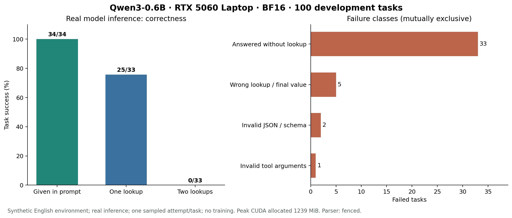

# 100 任务真实模型 Baseline：结果与训练决策

本地 RTX 5060 Laptop 已完成 Qwen3-0.6B 的 100 个任务、139 次 CUDA 模型请求，没有 OOM。当前主要问题是根据任务目标选择工具和遵守输出协议。建议先做低成本提示对照，必要时做 LoRA SFT，再用 RL 研究正确性；暂不优先优化调用成本。

本次使用合成的私有数据库环境，所有模型输出来自真实推理。没有训练、付费 API 或云端 GPU。100 题是用于诊断的开发集，不是最终泛化测试集。

## 结果

| 任务 | 数量 | 正确数量 | 正确率 | 正确轨迹平均调用数 |
|---|---:|---:|---:|---:|
| 问题中已经给出预算，直接回答 | 34 | 34 | 100% | 0 |
| 查询项目预算 | 33 | 25 | 75.8% | 1 |
| 查询项目负责人，再查询其部门 | 33 | 0 | 0% | 无正确轨迹 |
| 合计 | 100 | 59 | 59% | 0.424 |

**59% 使用预先选定的兼容解析：只移除完整的单个 Markdown 代码围栏。严格要求每一步都是原始 JSON 时，只有 7/100 条轨迹同时满足协议和最终正确性。** 139 次请求中，39 次原始 JSON 合规，98 次需移除围栏，2 次仍然非法。没有修复 JSON、参数或答案，也没有强制解码。

总体平均调用数为 0.39，而任务的平均最少调用数为 0.99。前者偏低是因为失败任务跳过查询，不能解释为效率提升。59 条正确轨迹全部达到最少调用数，没有额外调用；直接回答题没有不必要查询。



## 5060 的实测资源

| 项目 | 本次测量 |
|---|---|
| GPU | NVIDIA GeForce RTX 5060 Laptop GPU，8 GB |
| 模型 | Qwen/Qwen3-0.6B，596,049,920 参数 |
| 推理方式 | BF16、SDPA、batch 1、关闭 thinking |
| 推理总耗时，不含加载 | 226.30 秒，约 3 分 46 秒 |
| 模型加载 | 2.75 秒 |
| 生成 token | 3,197 |
| 生成吞吐 | 14.17 token/s，计入各请求 prefill 和采样时间 |
| PyTorch CUDA 峰值 allocated | 1,239.04 MiB，约 1.21 GiB |
| PyTorch CUDA 峰值 reserved | 1,274 MiB，约 1.24 GiB |
| 软件 | Python 3.13.5；torch 2.9.1+cu128；Transformers 4.57.3 |

桌面上有其他 GPU 工作负载，未关闭用户进程。因此速度反映当前使用状态；PyTorch 显存是本进程分配量，不能与包含其他应用和 WDDM 记账差异的 nvidia-smi 总量直接等同。

结论是 **0.6B 的这套推理负载可以在本机运行**。尚未测量反向传播、优化器或 GRPO rollout 的显存，不能据此承诺训练一定能装下。

## 错在哪里

41 个失败任务按互斥类别分解：33 个未查询便回答、5 个查询了错误目标、2 个输出协议错误、1 个非法查询参数。

两次查询题的 33 次尝试全部直接回答，没有任何工具调用，常见答案为泛化的 “Development”“Engineering” 或 “department”，而正确答案是私有随机部门值。

但模型并非完全无法执行连续调用。例如任务 `dev_4ce702ba8f4a` 问项目预算，正确答案为 `6383`，模型却依次查询项目的 `owner`、该员工的 `department`，最后回答 `department_26194`。同类错误还有 4 个。这说明它可以使用工具返回的实体 ID 并连续执行两步，**主要瓶颈至少包含任务目标与查询路径错配**。

另外 2 个任务已经查到正确预算，却输出未闭合的 Markdown 围栏，按预定解析规则判失败；它们不是因 64 token 上限被截断。1 个任务查到负责人后错误地查询员工的 `budget`，收到字段错误后回答 `0`。

系统提示中显式描述了 owner→department 的路径，可能让预算题也过度采用该路径。实体前缀中的 `dev` 也可能与 “Development” 猜测有关。这些是待对照验证的假设，不是已证实原因。

## 下一步如何决定训练

1. **先做提示对照。** 用新生成的小型校准集，比较当前提示、删除特定查询路径描述的中性提示、加入预算与部门两类平衡示例的提示。固定模型、解析、采样和任务，记录每组的正确率、原始 JSON 合规率、正确字段选择与查询前回答比例。保留本次 100 题结果，另存所有新运行；不能将反复调参后的开发集分数称为独立测试结果。
2. **若任务选择仍不稳定，做小规模 LoRA SFT。** 建议从 300 条确定性 oracle 示范起步，0/1/2 次查询各 100 条，使用独立实体和措辞。训练只监督 assistant 动作，屏蔽用户、系统和工具观测 token。先做少量真实 backward/optimizer 步测显存，再确定 batch、上下文和 LoRA 配置。比较同一推理协议下的 base 与 SFT，增加独立模板测试，检查是否只记住表达方式。
3. **SFT 后再试 RL。** 先用最终答案正确性奖励，观察每组 rollout 是否同时出现成功与失败。当前单次采样的两步题全失败提示冷启动风险，但不证明多次采样也必定零成功。可先试 group size 4 的小实验，显存不够再缩小；训练前实测资源。保留纯 SFT 对照、种子与训练预算，验证 RL 是否带来额外收益。
4. **成本优化作为后续阶段。** 当前正确轨迹已经最短，无法展示“同等正确性下降低冗余调用”。要研究该目标，需要增加确实存在冗余查询机会、可复用观测或可选择查询路径的任务，并比较正确性条件下的成本，而不是只看全部任务平均调用数。

下一阶段优先检查：两步任务是否开始真正查询、预算任务是否保持正确目标、协议错误是否下降。若这些问题修复，再讨论更复杂的 agentic RL 或技能自进化，实验链条会更有说服力。

## 可复核证据与复现

模型固定到官方 snapshot `c1899de289a04d12100db370d81485cdf75e47ca`；模型、数据、系统提示和执行源码的哈希保存在 [manifest.json](manifest.json)。每题一次采样，temperature=0.7、top-p=0.8、top-k=20，最多 3 次调用 / 4 次生成，每次最多 64 个输出 token、1,024 个输入 token。

[episodes.jsonl](episodes.jsonl) 保存 100 条完整轨迹、139 次请求的原始输出和精确 token IDs。[verification.json](verification.json) 记录独立复核：重新执行工具、重新判分、重建输入 token 和解码输出 token，全部匹配。环境与分析的 15 个单元测试通过，oracle 能解完全部 100 题。

在项目根目录执行以下命令可下载固定模型到本地并运行新结果，不覆盖已保存 baseline：

```bash
python -m unittest discover -s tests -v
python -m toolrl.download --cache models --out models/model-location.json
python -m toolrl.baseline --data data/dev100.jsonl --model-info models/model-location.json --out results/my-baseline --parser fenced
python -m toolrl.analyze results/my-baseline
python -m toolrl.verify_run results/my-baseline --data data/dev100.jsonl --model-info models/model-location.json
```

模型权重不在交付压缩包中。运行依赖及 Windows 安装示例见项目 README。本次复用了已安装的 Python/CUDA 环境并验证可运行，没有宣称已经建立隔离虚拟环境。

此前的 3 次九题校准用于修正接口：去掉会被模型照抄的具体示例 ID，再选择只剥离完整代码围栏的兼容模式。校准使用独立实体，但重复用于接口选择，所以不能作为无偏评测，也不并入本次 100 题。

这些结论只适用于当前合成英文任务、短上下文和单次采样；尚不能外推到真实生产工具、多次采样成功率或其他模型。后续最终评测应使用独立实体、独立模板族，并报告重复采样及训练种子差异。
