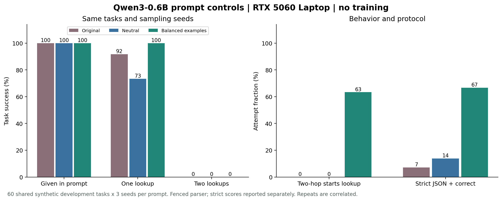

# 提示对照：真实模型实验结果

本轮仅改变系统提示；未进行 SFT、RL 或其他权重更新。
60 个新生成的开发任务，0/1/2 次查询各 20 个；每种提示使用相同任务与三个采样种子，因此每组为 180 次任务尝试。
**重复种子共享任务，180 次尝试不是 180 个独立任务。** 三组均使用与前次相同的模板族，只更换实体和私有事实；本轮不测量模板外泛化。

## 提示变化

- 原提示：与原 100 题 baseline 的系统提示完全相同。
- 中性提示：仅将具体 owner→department 路径说明替换为“owner 是 employee ID”。其他文字不变。
- 平衡示例：在中性提示后追加三段完整示范，分别涵盖直接回答、预算查询和负责人部门查询。示范使用独立实体和值，没有评测答案。示范采用系统提示内的文本对话，不是新增真实 tool messages。
- 平衡示例同时增加了输入长度和示范信息，因此不能单独归因于长度、格式示范或任务示范中的某一项。

## 正确性

| 提示 | 直接回答 | 一次查询 | 两次查询 | 总体 | 全程严格 JSON 且正确 |
|---|---:|---:|---:|---:|---:|
| 原提示 | 60/60 | 55/60 | 0/60 | 115/180 (63.9%) | 13/180 (7.2%) |
| 中性提示 | 60/60 | 44/60 | 0/60 | 104/180 (57.8%) | 25/180 (13.9%) |
| 平衡示例提示 | 60/60 | 60/60 | 0/60 | 120/180 (66.7%) | 120/180 (66.7%) |

主要正确性分数沿用 `fenced` 解析：只移除完整单个 Markdown 围栏，不修复 JSON、参数或答案。严格分数要求整条成功轨迹所有请求的原始输出直接符合 JSON 动作协议。



## 工具选择与协议

| 提示 | 私有任务首个查询正确 | 两步任务启动查询 | 预算题首次误查 owner | 请求原始 JSON 合规 |
|---|---:|---:|---:|---:|
| 原提示 | 58/120 | 0/60 | 0/60 | 63/238 (26.5%) |
| 中性提示 | 44/120 | 0/60 | 0/60 | 83/224 (37.1%) |
| 平衡示例提示 | 98/120 | 38/60 | 0/60 | 278/278 (100.0%) |

首个查询正确要求实体 ID 和字段同时等于 oracle 的第一步；启动查询只说明调用过工具，不等于完成了两步或答对。

## 每个种子的结果

| 提示 | 种子 | 直接回答 | 一次查询 | 两次查询 | 总体 |
|---|---:|---:|---:|---:|---:|
| 原提示 | 7 | 20/20 | 18/20 | 0/20 | 38/60 |
| 原提示 | 10007 | 20/20 | 18/20 | 0/20 | 38/60 |
| 原提示 | 20007 | 20/20 | 19/20 | 0/20 | 39/60 |
| 中性提示 | 7 | 20/20 | 16/20 | 0/20 | 36/60 |
| 中性提示 | 10007 | 20/20 | 15/20 | 0/20 | 35/60 |
| 中性提示 | 20007 | 20/20 | 13/20 | 0/20 | 33/60 |
| 平衡示例提示 | 7 | 20/20 | 20/20 | 0/20 | 40/60 |
| 平衡示例提示 | 10007 | 20/20 | 20/20 | 0/20 | 40/60 |
| 平衡示例提示 | 20007 | 20/20 | 20/20 | 0/20 | 40/60 |

## 相同题目与种子的成对比较

| 提示变化 | 失败变成功 | 成功变失败 | 两组都成功 | 两组都失败 |
|---|---:|---:|---:|---:|
| 原提示 → 中性提示 | 2 | 13 | 102 | 63 |
| 中性提示 → 平衡示例提示 | 16 | 0 | 104 | 60 |
| 原提示 → 平衡示例提示 | 5 | 0 | 115 | 60 |

种子相同用于配对比较；由于提示改变了输入，后续生成与随机数使用路径仍可能不同。成对比较不意味着两个条件生成过程逐 token 相同。

## 各措辞模板

| 任务与模板 | 原提示 | 中性提示 | 平衡示例 |
|---|---:|---:|---:|
| 直接回答，模板 0 | 21/21 | 21/21 | 21/21 |
| 直接回答，模板 1 | 21/21 | 21/21 | 21/21 |
| 直接回答，模板 2 | 18/18 | 18/18 | 18/18 |
| 一次查询，模板 0 | 18/21 | 15/21 | 21/21 |
| 一次查询，模板 1 | 19/21 | 11/21 | 21/21 |
| 一次查询，模板 2 | 18/18 | 18/18 | 18/18 |
| 两次查询，模板 0 | 0/21 | 0/21 | 0/21 |
| 两次查询，模板 1 | 0/21 | 0/21 | 0/21 |
| 两次查询，模板 2 | 0/18 | 0/18 | 0/18 |

## 资源与复核

- 全部完成 540 次真实 CUDA 任务尝试，独立验证 740 次请求的工具回放、判分、输入 token 与输出解码。
- 九个条件累计推理耗时 1188.67 秒；不含模型加载及验证。
- 最大 PyTorch CUDA allocated 为 1315.78 MiB；不是整机总显存或训练显存。
- 固定 Qwen3-0.6B snapshot、BF16、SDPA、batch 1、关闭 thinking；temperature 0.7、top-p 0.8、top-k 20。
- 每次最多 1,024 输入 token / 64 输出 token，每题最多 3 次调用 / 4 次生成。没有更换解析器、强制解码、重试修复或调用其他模型。
- 各种子轮换提示顺序，减轻固定执行顺序与桌面负载的混淆。采样未做跨平台逐位确定性保证。

## 停止原因

```json
{
  "原提示": {
    "answered": 177,
    "invalid_action": 3
  },
  "中性提示": {
    "answered": 179,
    "invalid_action": 1
  },
  "平衡示例提示": {
    "answered": 180
  }
}
```

## 复现与原始记录

实验前固定的方案、代码和提示哈希见 [plan.json](plan.json)，数值见 [summary.json](summary.json)。每个 `提示-seed种子` 目录保存 manifest、episodes、单轮分析与 verification；[failure_examples.json](failure_examples.json) 汇集部分失败轨迹便于人工阅读。

在项目根目录，用新的输出目录复现，避免覆盖这次记录：

```bash
python -m toolrl.prompt_study prepare --root results/my-prompt-control --data data/my-prompt60.jsonl
python -m toolrl.prompt_study run-all --root results/my-prompt-control --model-info models/model-location.json
python -m toolrl.prompt_study analyze --root results/my-prompt-control
python -m toolrl.prompt_report results/my-prompt-control
```

运行示意使用下载器生成的 models/model-location.json；本次使用 work 内的同一固定 snapshot。实验 runner 在单独进程中替换 baseline 的系统提示绑定，原 baseline/environment 文件没有修改，加载、生成、解析与工具执行仍由原引擎完成。

提示改善能证明表现对接口与示范敏感；持续失败只能表明这些提示尚未解决问题，不能证明模型绝对没有该能力。SFT 前应先固定有效接口，再用独立实体与独立模板评测学习收益。
