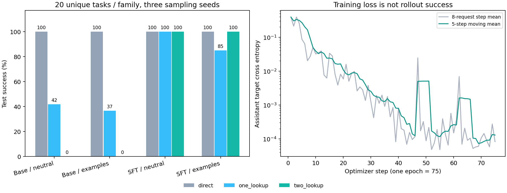

# 300 条轨迹 LoRA SFT：本地训练与最强提示基线对比

本次固定配置 SFT 比此前最强示例提示提高 54.4 个百分点。本轮两组未训练基线中得分较高的是「原模型 + 短协议」，85/180；与它相比，SFT 短协议差值为 +52.8 个百分点。5060 Laptop 8GB 完成了实际反向传播、优化器更新和真实工具交互评测。这里的结论限定在这套合成英语查询任务内。

## 独立测试结果

| 条件 | 直接回答 | 一步查询 | 两步查询 | 总正确率 | 严格 JSON 且答对 |
|---|---:|---:|---:|---:|---:|
| 原模型 + 短协议 | 60/60 | 25/60 | 0/60 | 85/180 (47.2%) | 16.1% |
| 原模型 + 此前最强示例提示 | 60/60 | 22/60 | 0/60 | 82/180 (45.6%) | 45.6% |
| SFT + 短协议 | 60/60 | 60/60 | 60/60 | 180/180 (100.0%) | 100.0% |
| SFT + 同一示例提示 | 60/60 | 51/60 | 60/60 | 171/180 (95.0%) | 95.0% |

每个条件有 **60 个独立测试任务 × 3 个采样种子 = 180 次尝试**。每类是 20 个任务重复三次，不能写成 180 个独立问题。四个条件合计 720 次测试尝试；开发集另有 120 次。实体、私有值和测试措辞均与训练隔离，但工具 schema 和两步组合模式相同。

| 采样种子 | 原模型短协议 | 原模型示例提示 | SFT短协议 | SFT示例提示 |
|---|---:|---:|---:|---:|
| 7 | 29/60 | 27/60 | 60/60 | 58/60 |
| 10007 | 28/60 | 27/60 | 60/60 | 57/60 |
| 20007 | 28/60 | 28/60 | 60/60 | 56/60 |

预先固定的主要部署对比是「SFT 短协议 vs 原模型此前最强示例提示」，同时保留同提示的 base/SFT 对照。主要配对对比中，由错转对 **98** 次，由对转错 **0** 次，两者均对 **82** 次，两者均错 **0** 次。另报告本轮较强的未训练基线，避免只与较弱条件比较；该较强基线是测试后描述性对比，并未用于重新训练或选模型。三个种子复用了同一批问题，不能把这些计数当作独立样本做显著性推断。

开发集在训练前重跑：原模型短协议 18/30、此前最强示例提示 20/30，两步分别为 0/10 和 0/10；SFT 短协议 30/30，SFT 示例提示 30/30。开发集用于诊断，最终 adapter 固定为一轮的最后一次更新。所有测试生成发生在 adapter 保存并哈希锁定之后，没有依据测试分数选择 checkpoint、学习率或轮数。

## 提升发生在哪里

此前示例提示在开发集上最强，换成保留措辞后不能假设这个排序仍然成立。一步任务按测试措辞展开如下，可检查格式正确但没有读取私有值的失败：

| 一步查询的测试措辞 | 原模型短协议 | 原模型示例提示 | SFT短协议 | SFT示例提示 |
|---|---:|---:|---:|---:|
| Please retrieve the stored budget amount for {project}. | 21/21 | 21/21 | 21/21 | 21/21 |
| Using the company records, report the budget for {project}. | 0/21 | 0/21 | 21/21 | 18/21 |
| What number is saved in the budget field of {project}? | 4/18 | 1/18 | 18/18 | 12/18 |

最强提示基线的两步尝试中，开始查询 32/60 次，首步正确查询 owner 32/60 次，完成正确 owner → department 查询前缀 0/60 次，最后答对 0/60 次。

SFT 短协议相应为 60/60、60/60、60/60、60/60。它向实际工具返回的 employee ID 查询 department 60/60 次。最强提示基线复制示例 department 的次数是 38，直接把实际 owner ID 当最终答案的次数是 14；SFT 短协议分别是 0 和 0。

原模型最强提示原始 JSON 有效率为 229/234（97.9%），SFT 短协议为 360/360（100.0%）。查询链指标与最终答案一起看，才能区分格式改善和决策改善。

SFT 短协议有 60/60 个问题在三个种子下都正确，0 个问题结果不稳定。正确轨迹额外查询总数为 0，无效工具调用 0 次；生成截断 0 次、上下文超限 0 次。调用成本必须以正确性为前提比较，基线过早回答造成的低调用数不能视作效率收益。

同一 adapter 加入示例后，从短协议正确变成错误 9 次，从错误变成正确 0 次。SFT 加示例的总分是 171/180；更长的示例提示没有自动带来更好结果。训练使用短协议，而示例条件加入额外的固定实体和值，因此这个对照同时改变了提示长度与示例内容，不能单独归因于某一因素。例如 `test_0028` 的同一任务种子 `3407`，问题是「What number is saved in the budget field of project_e515ae37d16f?」。加入示例后的动作是 `[{"action":"answer","value":51578437}]`，实际答案应为 `6276`。完整配对记录见 [prompt-interference-cases.jsonl](prompt-interference-cases.jsonl)。

## 数据修正与监督方式

项目和员工使用独立随机的 12 位十六进制 ID，不再共享后缀。真实实体与干扰实体使用同一 ID 格式。训练、开发、测试的实体和私有值交集均为零，并排除提示中固定的示例答案，避免复制示例偶然命中。

划分为训练 300 条（每类 100）、开发 30 条（每类 10）、测试 60 条（每类 20）。训练和开发使用四种措辞，测试使用每类三种保留措辞。训练内有 40 对同一项目、不同目标的轨迹：预算目标应查 budget，部门目标应查 owner 再查 department。共 260 组训练事实，配对复用只发生在训练内部。

300 条正确 oracle 轨迹生成 **600 个下一步决策目标**：直接回答 100、一步轨迹 200、两步轨迹 300，其中包含 100 个关键的「已经拿到 owner，下一步继续查询」状态。oracle 先实际执行工具并验证，再导出目标；训练输入只包含问题、之前的动作与工具结果，不含未来观察或 expected 字段。

每个决策独立应用模型原生 chat template，关闭 thinking；prefix 标签全部为 -100，只监督下一条紧凑 JSON 和 EOS。每个决策的 assistant token loss 先取均值，再对累积组取均值；两步轨迹贡献三个决策状态。没有 packing、没有静默截断。完整 [supervision.jsonl](training/supervision.jsonl) 保存实际 token IDs 和 loss mask。

## 5060 的实测训练显存

| 测量 | 真实优化器步数 | 实际 microbatch 数 | PyTorch 峰值 allocated | 峰值 reserved | 优化循环时间 |
|---|---:|---:|---:|---:|---:|
| 显存探针，权重丢弃 | 8 | 64 | 2.89 GiB | 3.04 GiB | 13.36 秒 |
| 正式 SFT，重新初始化 | 75 | 600 | 2.88 GiB | 4.84 GiB | 102.58 秒 |

训练器记录的加载、开发集 loss 评估、优化与保存共 113.77 秒，不含 Python 启动和库导入。显存探针重复八个最长决策上下文，只用于检验显存；它不是完整训练，也未用于最终评测。正式训练与探针具有相同初始 adapter 哈希、不同最终哈希，确认没有沿用探针权重。

配置为 Qwen3-0.6B（固定 revision）、BF16 冻结主干、FP32 LoRA、q_proj/v_proj、rank 8、alpha 16、dropout 0.05，microbatch 1、累积 8，AdamW 学习率 1e-4、weight decay 0、gradient clip 1.0、seed 42、一轮。实际可训练参数 1,146,880。没有量化或 CPU offload，gradient checkpointing 关闭。配置上下文上限 768，**实测最长序列仅 406 tokens**；长上下文训练和 GRPO 的显存不能由此推断。

开发集 teacher-forced loss 从 0.426715 降到 0.00008490。它只衡量给定正确历史时的下一步预测；上面的真实多轮 rollout 才检验模型能否自己走到后续状态。PyTorch allocated/reserved 是该进程指标，桌面应用还会占用额外显存。

## 一条实际配对轨迹

任务 `test_0057`，实际任务种子 `7`：

> From company records, give the department of the person marked as the owner of project_8c13141d6bdb.

最强提示基线的实际动作：

```json
[
  {
    "action": "lookup",
    "entity": "project_8c13141d6bdb",
    "field": "owner"
  },
  {
    "action": "answer",
    "value": "department_2fa8a8624551"
  }
]
```

SFT 短协议的实际动作：

```json
[
  {
    "action": "lookup",
    "entity": "project_8c13141d6bdb",
    "field": "owner"
  },
  {
    "action": "lookup",
    "entity": "employee_2fa8a8624551",
    "field": "department"
  },
  {
    "action": "answer",
    "value": "department_18498"
  }
]
```

SFT 实际收到的工具结果：

```json
[
  {
    "entity": "project_8c13141d6bdb",
    "field": "owner",
    "value": "employee_2fa8a8624551"
  },
  {
    "entity": "employee_2fa8a8624551",
    "field": "department",
    "value": "department_18498"
  }
]
```

最终验证答案为 `department_18498`。动作和观察来自实际生成记录，没有用 oracle 补齐缺失步骤。

短协议相对于此前示例基线的全部由错转对案例，以及短协议 SFT 失败案例（若有），保存在 [case-comparisons.jsonl](case-comparisons.jsonl)；加示例后的退步另存于 [prompt-interference-cases.jsonl](prompt-interference-cases.jsonl)。可回到各条件的 episodes.jsonl 检查原始字符串和精确 token。

## 证据与解释范围

本轮共 **840 个真实模型 episode、1356 个模型请求**完成独立复核。复核重放工具、重新判答案、重建输入 token 和解码输出 token，同时核验条件配置、数据、提示、源代码和 adapter 哈希。复核验证记录的一致性与执行来源，不是重新运行模型生成。

[训练审计](training-audit.json) 确认 600 个目标恰好各暴露一次，完整 loss mask 可重建，保存的 safetensors 与训练后权重哈希一致，文件中只含 LoRA 张量。主干冻结且不进入优化器，训练器逐步检查主干没有梯度。没有 API 调用、云 GPU 或 RL。全部复现命令见 [reproduce.md](reproduce.md)，模型加载与适用范围见 [model-card.md](model-card.md)。

旧的 100 题和提示实验保留原始字节，不与本轮新划分分数直接配对或混算。旧通用 analyzer 的 caveat 描述的是 inference 进程；本轮实际训练和测试划分以本报告及 [summary.json](summary.json) 为准。

一次训练种子、三次共享任务的采样重复，仍不足以证明通用 agent 能力。测试保留的是措辞、实体和事实，并未保留全新工具或规划结构。这次结果支持小模型能够在此 schema 上通过少量监督学会或激活所需策略；不能据此断言此前失败代表模型容量上限，也不能宣称 RL 或 RSI 已完成。

## 下一步判断

短协议在当前测试上已经饱和，继续增加同类 SFT 轮数或直接做 GRPO 的信息增益有限。下一轮先建立新的压力测试：三至四步链、可省略的查询、不同信息已给出的情况、工具报错与恢复，以及新工具字段。把开发集与最终测试重新划分，先复测这次固定 adapter，再依据失败类型决定补 SFT 还是开始 RL。

面试材料可以如实描述为：构建有数据审计和独立轨迹复核的工具决策环境，在 8GB 本地 GPU 上用 300 条 oracle 轨迹进行 LoRA SFT，与固定最强提示基线做配对比较，并分析查询链、协议有效率和调用成本。把「合成环境、60 个独立测试问题、三次采样、单训练种子」与结果一并说明。


