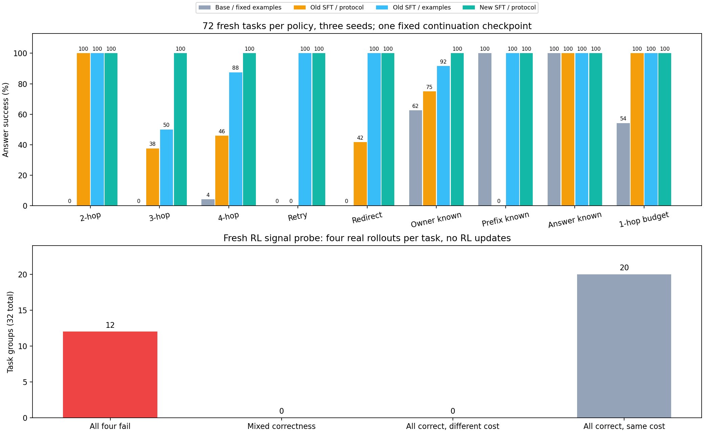

# 第二轮 SFT：单动作边界、长链与报错恢复

已在 RTX 5060 Laptop 8GB 完成旧 adapter 的继续训练与独立对照。补训后简洁提示为 **216/216（100.0%）**，补训前同提示为 **120/216（55.6%）**。本轮最终 checkpoint 由预定一轮训练确定，没有用测试或奖励诊断选模型。RL 部分只采样和诊断，没有策略梯度更新。

## 新测试上的对照

开发集自由 rollout：未训练模型＋固定强提示 12/27（44.4%）；补训前 SFT＋简洁提示 18/27（66.7%）；补训前 SFT＋强提示 27/27（100.0%）；补训后 SFT＋简洁提示 27/27（100.0%）。开发集不用于重新选择提示或 checkpoint；teacher-forced loss 在下面独立报告。

| 场景 | 未训练模型＋固定强提示 | 补训前 SFT＋简洁提示 | 补训前 SFT＋强提示 | 补训后 SFT＋简洁提示 |
|---|---:|---:|---:|---:|
| 两步锚点 | 0/24（0.0%） | 24/24（100.0%） | 24/24（100.0%） | 24/24（100.0%） |
| 三步查询 | 0/24（0.0%） | 9/24（37.5%） | 12/24（50.0%） | 24/24（100.0%） |
| 四步查询 | 1/24（4.2%） | 11/24（45.8%） | 21/24（87.5%） | 24/24（100.0%） |
| 临时错误重试 | 0/24（0.0%） | 0/24（0.0%） | 24/24（100.0%） | 24/24（100.0%） |
| 失效 ID 恢复 | 0/24（0.0%） | 10/24（41.7%） | 24/24（100.0%） | 24/24（100.0%） |
| 已知 owner | 15/24（62.5%） | 18/24（75.0%） | 22/24（91.7%） | 24/24（100.0%） |
| 已知链前缀 | 24/24（100.0%） | 0/24（0.0%） | 24/24（100.0%） | 24/24（100.0%） |
| 已知答案 | 24/24（100.0%） | 24/24（100.0%） | 24/24（100.0%） | 24/24（100.0%） |
| 旧单步预算查询 | 13/24（54.2%） | 24/24（100.0%） | 24/24（100.0%） | 24/24（100.0%） |
| **合计** | **77/216（35.6%）** | **120/216（55.6%）** | **199/216（92.1%）** | **216/216（100.0%）** |

| 种子 | 未训练模型＋固定强提示 | 补训前 SFT＋简洁提示 | 补训前 SFT＋强提示 | 补训后 SFT＋简洁提示 |
|---|---:|---:|---:|---:|
| 7 | 26/72（36.1%） | 41/72（56.9%） | 67/72（93.1%） | 72/72（100.0%） |
| 10007 | 26/72（36.1%） | 39/72（54.2%） | 66/72（91.7%） | 72/72（100.0%） |
| 20007 | 25/72（34.7%） | 40/72（55.6%） | 66/72（91.7%） | 72/72（100.0%） |

每个条件重复 72 个测试任务、三个种子，共 216 次尝试；不是 216 个独立任务。测试九类各八任务，所有测试事实与新训练、开发、奖励诊断及历史数据隔离。训练复用上一轮已查看的开发/测试措辞，但只用新事实；本轮开发和测试采用另外的新措辞。数字取值范围、工具 schema、提示、采样和预算保持一致。事实组内复用只发生在训练：40 对目标对照；开发、测试和 signal 分别使用独立事实。

补训前后同提示配对：由错转对 96 次，由对转错 0 次，均对 120 次，均错 0 次。固定强提示来自上一轮开发集选择，本轮不重新按测试选择。

补训后 72/72 个任务在三个种子下都正确，0 个任务结果随种子变化，0 个任务三次全错。各条件逐题重复采样的一致性见 summary.json 的 test_task_consistency；不把重复尝试当作独立样本计算置信区间。

## 学到了什么，仍在哪里失败

补训后严格 JSON 且答对 216/216，工具可溯源答对 216/216。正确轨迹共 0 次额外查询，216 条达到最少调用。补训前同提示含 `Tool:` 的请求 0 次，补训后 0 次；含多个 `"action"` 标记的请求分别为 19、0，这是原始文本诊断而非额外解析/修复规则；截断请求分别为 19、0。

新模型失败停止原因：`{}`。每类真实错误暴露、恢复动作和成本见 [summary.json](summary.json)。原始错误、动作与输出见 [diagnostic-cases.jsonl](diagnostic-cases.jsonl)。这里的动作可靠性和成功率仅对应控制合成环境，不能推广为通用 agent 或 RSI 能力。

事后审计 1435 个已执行 oracle 的紧凑下一动作 JSON 拼写（含 EOS），最长 30 tokens，均小于 64-token 上限，见 [action-budget-audit.json](action-budget-audit.json)。这不覆盖所有合法空白/键顺序拼写，但排除了标准单动作本身就无法放入预算的问题；审计没有生成模型输出或改变 checkpoint。

## 真实训练与显存

300 条轨迹，990 个 assistant 下一动作目标，其中 80 个目标紧接实际错误观察。目标只有一个合法 JSON 和 EOS；system/user/tool/past assistant 全部 mask 为 -100，不监督伪造工具结果。新训练按长链 100、恢复 80、已知信息 60、旧目标 60 的方案分配，给定答案类合计 40，其中 20 保留旧直接预算目标。

继续训练已保存的 v1 q/v LoRA（r=8、alpha=16、dropout=0.05），主干 BF16 冻结，LoRA FP32；AdamW lr=1e-4，microbatch=1、累积 8、seed=42，一轮 **124 个 optimizer steps**。每个训练目标恰好使用一次，初始 state 哈希与 v1 完全一致，最终 adapter 已改变，主干没有梯度。监督 token 对齐、EOS、步骤覆盖与旧权重哈希已独立审计，见 [training-audit.json](training-audit.json)。

最长实际序列 715 tokens，上限 1024，无截断训练。八步最长上下文探针成功，allocated 4.54 GiB、reserved 4.84 GiB；探针权重丢弃。正式训练重新从旧 adapter 开始，allocated **2.40 GiB**、reserved **8.28 GiB**，优化循环 1417.46 秒，gradient checkpointing=True。运行期间同卡还有其他训练/评测及桌面负载，耗时不能当作独占 GPU 的吞吐基准。allocated/reserved 是本进程 PyTorch 指标，分别代表张量分配峰值与缓存保留峰值，不等于整卡可用空间或所有进程的总显存。这适用于该小模型 LoRA 和实际序列长度。

开发集 teacher-forced 平均损失 0.0327745 → 0.00141201。它是给定正确历史状态的下一动作损失，不等于自由 rollout 成功率，二者分开报告。

本次缓存保留峰值超过名义 8GB 物理显存；Windows WDDM 可涉及共享显存/分页，因此完成运行不等于全程驻留独占 VRAM。未逐页测量迁移量，不能给出纯物理显存吞吐或据此保证其他环境也能运行。

默认缓存尝试在 11 个已记录更新后主动中止，仅使用缓存回收的尝试又在 37 步后中止，两者均未保存 adapter；变长样本的缓存保留量继续增长，第二次中止前超过名义整卡显存。记录保存在 training-attempt-default-cache、training-attempt-gc-cache。进一步使用 `backend:native,max_split_size_mb:64,garbage_collection_threshold:0.6` 的缓存尝试也未能解决问题。中止权重没有用于后续评测。缓存尝试记录见 [resource-retry.json](resource-retry.json)；[PyTorch 2.9 缓存文档](https://docs.pytorch.org/docs/2.9/notes/cuda.html#optimizing-memory-usage-with-pytorch-cuda-alloc-conf)说明回收和限制大块拆分设置。

大块拆分尝试在 2 个已记录更新后也主动中止，reserved 达 15.39 GiB；记录在 training-attempt-split-cache。未出现 CUDA OOM，但缓存保留量超过名义显存且训练严重变慢。因此在任何评测输出产生前，把资源回退触发条件从仅 OOM 扩为 OOM 或严重显存压力，并启用已有的非重入 checkpointing。原计划保存在 [plan-original.json](plan-original.json)，仅 memory_test 字段调整为当前 [plan.json](plan.json)，审计验证其他字段完全相同，见 [resource-amendment.json](resource-amendment.json)。数据、提示、种子、源码、学习率、更新次数和最终 checkpoint 规则不变。checkpointing 八步探针 allocated 2.40 GiB、reserved 2.74 GiB；探针再次丢弃。正式训练从 v1 adapter 与新 optimizer 重新开始，使用 `PYTORCH_CUDA_ALLOC_CONF=backend:native,garbage_collection_threshold:0.5` 与 `--checkpointing`。这属于明确记录的资源计划调整，而非完全未偏离原计划的运行。

## 全新 32 题 × 4 条 rollout：奖励信号

新模型使用简洁提示；每题四个独立采样根种子 30007、40007、50007、60007，共 128 个真实 episode。32 个任务八种预定组合各四题；schema 相同，但「长链＋故障」「已知前缀＋故障」组合没有作为训练类别使用。任务在训练前冻结并与所有划分隔离，只有完成对照评测后才开放采样。

| 组合 | 答对 / 16 | 真正遇错的尝试 | 遇错后答对 | 正确轨迹额外调用 |
|---|---:|---:|---:|---:|
| chain_four | 8/16 | 0 | 0 | 0 |
| chain_three | 8/16 | 0 | 0 | 0 |
| prefix_redirect | 16/16 | 16 | 16 | 0 |
| prefix_retry | 16/16 | 16 | 16 | 0 |
| redirect_four | 8/16 | 8 | 8 | 0 |
| redirect_three | 8/16 | 8 | 8 | 0 |
| retry_four | 8/16 | 8 | 8 | 0 |
| retry_three | 8/16 | 8 | 8 | 0 |

合计 **80/128（62.5%）**，工具可溯源成功 80，正确轨迹额外查询 0。

### signal 中的新失败与措辞关联

| signal 类别 | 模板 0（2 题 × 4） | 模板 1（2 题 × 4） |
|---|---:|---:|
| chain_four | 8/8（100.0%） | 0/8（0.0%） |
| chain_three | 8/8（100.0%） | 0/8（0.0%） |
| prefix_redirect | 8/8（100.0%） | 8/8（100.0%） |
| prefix_retry | 8/8（100.0%） | 8/8（100.0%） |
| redirect_four | 8/8（100.0%） | 0/8（0.0%） |
| redirect_three | 8/8（100.0%） | 0/8（0.0%） |
| retry_four | 8/8（100.0%） | 0/8（0.0%） |
| retry_three | 8/8（100.0%） | 0/8（0.0%） |

长链六类的模板 0 使用 “ownership chain”，模板 1 使用 “employee responsible for”。prefix 两类的两种措辞另行定义在 sft2_data.py。每格只有两个独立事实任务，各重复四次；不同模板没有复用同一事实。signal 同时改变了措辞和部分故障组合，不能把成功率变化全部归因为故障组合，以上是事后描述性分层，不是隔离的措辞因果实验。

失败轨迹中 47 次第一条动作把 project 的字段写成非法的 `employee`；project 合法字段是 `owner` 和 `budget`。实际 `unknown_field` 错误 182 次，`unknown_entity` 错误 76 次；工具的 unknown_field 返回 allowed_fields，但部分轨迹仍反复查无效字段。共有 48 次失败尚未遇到预设可恢复错误；真正遇到可恢复错误的 64 次里，64 次答对。标准测试的 216/216 不能推广为这个新分布上的成功率。

当前训练紧接错误的监督类型为 `{"temporary_unavailable": 40, "entity_moved": 40}`，未覆盖学生自行产生的 unknown_field/unknown_entity 状态。动作边界改善与 schema 语义泛化、非重试错误纠正是不同问题：这里的重复合法 JSON 仍可反复发出非法查询。下一轮可用同事实措辞对照验证关联，再添加真实执行的错误前缀＋合法纠错目标；保持现有测试与 signal 结果封存，未来训练和最终测试另生成。

32 个任务组分类：`{"all_correct_same_cost": 20, "all_failed": 12}`。非恒定奖励 **0/32 组**，逐题奖励、方差、调用数和停止原因见 [reward-signal.json](reward-signal.json)。

若同题四个奖励都是常数，`R_i − mean(R)` 全为零；在跳过零方差组或加 epsilon 的安全实现中，该组没有组内相对奖励优势。不同调用数的失败仍都得到零，这是当前正确性门控奖励的预定行为，不会把更早放弃误奖励为效率提升。恒定组结论仅针对当前四次采样；不能推断其他采样配置下永远没有成功概率。

诊断保持旧奖励 `R = exact_correct × (1 − 0.03 × calls)`，错误调用也计费，必要重试没有额外的重复字符串惩罚。按同一任务比较时其最少调用成本是常数；全错组为零、全对等成本组为常数，不能当作有成本优化信号。exact 与工具可溯源正确分别复核，避免把私有值猜中误认成查询能力。未生成用于 RL 更新的旧策略 log-prob，也未计算策略梯度。

当前奖励大多恒定，暂不进入 GRPO 优化。先在新的训练分布确认哪些组合能同时产生成功和失败，必要时补恢复组合监督；全错组没有成功排序信号，全对等成本组也没有相对奖励差异。优先做同事实、仅换措辞的对照，再补实体类型/字段名绑定与 unknown_field 之后的合法纠错状态；不要把所有工具错误都按暂时错误机械重试。

[GRPO 原论文 §4.1.2](https://arxiv.org/html/2402.03300v3#S4.SS1.SSS2) 用同题组内相对奖励构造优势；恒定奖励需要处理零方差。本次 G=4 的方差只是有限样本诊断，不证明下一轮 RL 一定增益。未来若开始 RL，训练任务须另生成，保留 assistant-only 策略损失、真实 old-policy log-prob 与独立最终测试，并实测 rollout、backward、optimizer 的联合显存。

## 证据与复现

本轮独立复核 **1100 个评测/诊断 episode、3086 个模型生成请求**。输入 token 重建、输出 token 解码、工具重放、答案及成本重判、恢复计数和 EOS 截断标记一致；新旧 adapter、数据、提示和执行源文件与冻结计划相符。复核是记录一致性验证，不是重新生成输出。

完整对照在采样奖励诊断前已汇总到 [test-analysis-before-signal.json](test-analysis-before-signal.json)，最终审计核对其分数和配对结果与最终报告一致，并验证分析时间早于四组 signal 的开始时间。

固定 Qwen3-0.6B revision，温度 0.7、top-p 0.8、top-k 20，thinking off，每回合 64 新 tokens，六次查询、七个输出回合，batch 1。推理 allocated 峰值 1.74 GiB，reserved 3.25 GiB。完整配置在 [plan.json](plan.json)，运行步骤在 [reproduce.md](reproduce.md)，新 adapter 在 training/adapter；旧 adapter 字节保持不变。

